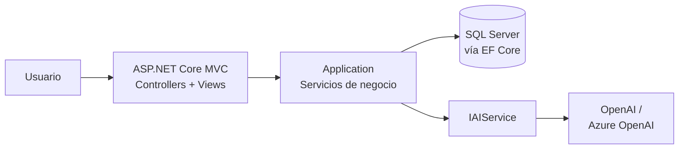
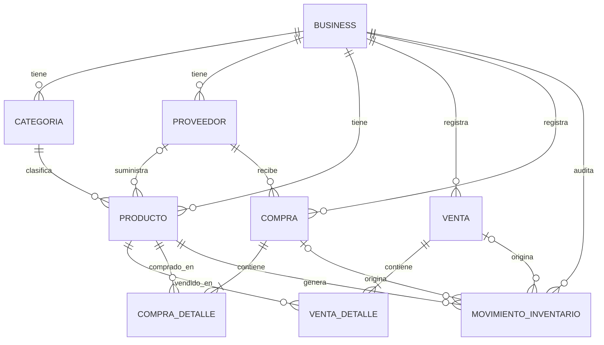

# SmartStock AI

**Sistema de gestión e inventario inteligente para pequeños negocios salvadoreños** (minisúper, ferreterías,
papelerías, farmacias pequeñas, librerías).

Centraliza productos, inventario, ventas, compras, proveedores y reportes, y usa **inteligencia artificial** para
convertir los datos del negocio en recomendaciones: qué reponer, qué se mueve más o menos que el mes anterior y por qué.

> Universidad Don Bosco · Escuela de Computación · Proyecto Fase II (desarrollo, implementación e integración).

## Contenido

1. [Equipo](#equipo)
2. [El problema y la solución](#el-problema-y-la-solución)
3. [Funcionalidades](#funcionalidades)
4. [Tecnologías](#tecnologías)
5. [Arquitectura](#arquitectura)
6. [Estructura del repositorio](#estructura-del-repositorio)
7. [Inteligencia artificial](#inteligencia-artificial)
8. [Base de datos](#base-de-datos)
9. [Instalación y ejecución](#instalación-y-ejecución)
10. [Variables de entorno y configuración](#variables-de-entorno-y-configuración)
11. [Pruebas](#pruebas)
12. [Seguridad](#seguridad)
13. [Despliegue en Azure](#despliegue-en-azure)
14. [Limitaciones conocidas](#limitaciones-conocidas)
15. [Flujo de trabajo del equipo](#flujo-de-trabajo-del-equipo)
16. [Documentación](#documentación)

## Equipo

| Integrante | Rol / aportes principales |
|---|---|
| _Dominic Alejandro Castillo González_ | _Infrastructura_ |
| _Joel Eliseo Recinos Benitez_ | _Test y Web_ |
| _Carmen Abigail Granados Carmona_ | _Web_ |
| _Joaquín Emmanuel Ayala Orellana_ | _Domain_ |
| _Gabriel Antonio Hernández Cañas_ | _Application_ |

## El problema y la solución

Muchas MYPEs llevan su inventario en cuadernos u hojas de cálculo: se enteran de que un producto se agotó cuando
un cliente lo pide, compran por intuición y no saben qué mercadería lleva meses sin moverse.

SmartStock AI registra cada compra, venta y ajuste de inventario con trazabilidad completa, y sobre esos datos:

- **Reglas determinísticas** (siempre activas): alertas de stock bajo o agotado, cálculo de totales, validación de existencias.
- **IA como apoyo a la decisión**: interpreta métricas ya calculadas y sugiere acciones con su justificación.
  La IA **nunca modifica el inventario ni crea compras por sí sola**.

## Funcionalidades

| Módulo | Qué permite |
|---|---|
| **Autenticación** | Login, registro de negocio, recuperación por correo y cambio de contraseña, bloqueo tras intentos fallidos |
| **Usuarios y roles** | El administrador crea usuarios, asigna rol (Administrador, Vendedor, Inventario), los desactiva y restablece contraseñas; cada rol ve y hace solo lo que le corresponde |
| **Configuración** | Datos del negocio y la opción explícita de permitir ventas sin stock (desactivada por defecto) |
| **Multi-negocio** | Cada negocio (tenant) solo accede a sus propios datos |
| **Dashboard** | Ventas del día y del mes, valor del inventario, stock bajo, más vendidos, compras recientes, tendencia de 7 días, alertas y recomendaciones de IA bajo demanda |
| **Productos** | CRUD, búsqueda por nombre/SKU, filtro por categoría y por stock bajo, paginación, desactivación |
| **Categorías y proveedores** | CRUD con desactivación |
| **Inventario** | Entradas, salidas y ajustes manuales con historial de movimientos (producto, tipo, cantidad, fecha, usuario, motivo) |
| **Ventas** | Carrito con búsqueda de productos, descuentos, método de pago, rechazo por stock insuficiente, anulación que restaura el inventario |
| **Compras** | Selección de proveedor, costos por línea, actualización automática de stock y costo, anulación |
| **Reportes** | Ventas, más vendidos, compras, inventario, movimientos, baja rotación y ganancias estimadas, con filtros por fecha, producto, categoría y proveedor; exportación a CSV |
| **Recomendaciones IA** | Análisis del inventario con evidencia de datos de entrada, procesamiento y resultados |

La interfaz sigue los prototipos UX/UI definidos en la Fase I (login, dashboard, gestión de productos, inventario,
ventas y compras) con la paleta verde `#4fba93` y gris oscuro `#2d3748`.

## Tecnologías

| Capa | Tecnología |
|---|---|
| Lenguaje y plataforma | C# 14 · ASP.NET Core 10 (MVC) · .NET 10 |
| Acceso a datos | Entity Framework Core 10 · SQL Server 2022 (Azure SQL Database como destino en la nube) |
| Autenticación | ASP.NET Core Identity (roles, hash de contraseñas, bloqueo de cuenta) |
| IA | OpenAI API o Azure OpenAI (intercambiables por configuración) |
| Interfaz | Razor Views · Bootstrap 5 · Chart.js · Font Awesome |
| Contenedores | Docker (build multi-stage) · Docker Compose |
| Pruebas | xUnit · SQLite en memoria para integración |

## Arquitectura

Arquitectura limpia en capas. Las dependencias apuntan en una sola dirección:
`Web → Infrastructure → Application → Domain`. La lógica de negocio no conoce EF Core, Identity ni el proveedor de IA.



| Proyecto | Responsabilidad |
|---|---|
| `SmartStockAI.Domain` | Entidades, enumeraciones, contratos de repositorio y reglas propias de las entidades |
| `SmartStockAI.Application` | DTOs, interfaces y servicios de negocio (ventas, compras, inventario, dashboard, reportes, recomendaciones) |
| `SmartStockAI.Infrastructure` | `DbContext`, configuraciones EF, migraciones, repositorios, Identity, seed y cliente de IA |
| `SmartStockAI.Web` | Controladores, vistas, ViewModels y archivos estáticos |
| `SmartStockAI.Tests` | Pruebas unitarias y de integración |

Decisiones de diseño relevantes:

- **El stock nunca se modifica sin dejar un `MovimientoInventario`.** Venta, compra, anulación y ajuste manual pasan por la
  misma bitácora; una anulación agrega un movimiento de reverso en lugar de borrar el original.
- **Operaciones atómicas.** `IUnitOfWork.ExecuteInTransactionAsync` envuelve "registrar venta + reducir stock + registrar
  movimiento"; si algo falla, no queda nada a medias.
- **Validar antes de modificar.** Una venta con varias líneas verifica todo el stock antes de tocar cualquier producto.
- **Aislamiento por negocio.** Toda entidad operativa lleva `BusinessId`; el del usuario viaja como claim de la sesión y
  cada consulta lo filtra.
- **Proveedor de IA desacoplado** detrás de `IAIService`.

## Estructura del repositorio

```text
.
├── src/
│   ├── SmartStockAI.Domain/
│   ├── SmartStockAI.Application/
│   ├── SmartStockAI.Infrastructure/     # incluye Data/Migrations y AI/
│   ├── SmartStockAI.Web/
│   ├── SmartStockAI.Tests/
│   └── SmartStockAI.sln
├── docs/                                # manuales, pruebas y propuesta de Azure
├── database/                            # schema.sql generado desde las migraciones
├── docker/
│   ├── Dockerfile
│   └── docker-compose.yml
├── .env.example
├── .dockerignore
├── .gitignore
└── README.md
```

## Inteligencia artificial

**Funcionalidad:** sistema de recomendaciones sobre el inventario (menú **IA → Analizar inventario**).

### Flujo

1. **Entrada.** El backend calcula, por producto, métricas determinísticas: stock, stock mínimo, unidades vendidas en los
   últimos 30 días, en los 30 días previos y días desde la última venta. Solo se envían los 80 productos más críticos.
2. **Procesamiento.** Esas métricas viajan al proveedor de IA con un prompt especializado en inventarios, que le exige usar
   únicamente los datos recibidos, no inventar cifras, omitir lo que no tenga información suficiente y responder en JSON.
3. **Validación.** El backend **no confía en el texto del modelo**: descarta productos que no se enviaron, tipos o
   prioridades fuera del vocabulario permitido, razones vacías, y limita la confianza al rango 0–1.
4. **Resultado.** La pantalla muestra los datos enviados, el procesamiento (proveedor, modelo, duración), las alertas por
   reglas, las recomendaciones de la IA y el beneficio aportado.

Ejemplo de recomendación validada:

```json
{
  "productId": 2,
  "type": "LOW_STOCK",
  "priority": "HIGH",
  "recommendation": "Considerar reponer el producto esta semana.",
  "reason": "Stock 8 frente a un mínimo de 20 y ventas de 15 unidades en los últimos 30 días.",
  "confidence": 0.87
}
```

Tipos: `LOW_STOCK`, `HIGH_DEMAND`, `LOW_ROTATION`, `PURCHASE_RECOMMENDATION`, `SALES_TREND`, `GENERAL_ALERT`.

### Principios

- **Reglas determinísticas primero.** Una alerta de stock bajo (`stock ≤ mínimo`) la genera siempre el backend; la IA solo
  aporta contexto y priorización.
- **Minimización de datos.** Solo viajan 8 campos por producto: sin precios, proveedores ni datos de usuarios.
- **Degradación elegante.** Sin clave, o si el proveedor falla, el sistema sigue mostrando los datos de entrada y las alertas
  por reglas, con un aviso. Los errores técnicos se registran en el log y nunca se muestran al usuario.
- **Proveedor intercambiable.** Cambiar entre OpenAI y Azure OpenAI es solo configuración (`AI__Provider`).

## Base de datos

Modelo relacional en SQL Server, con migraciones de Entity Framework Core (`src/SmartStockAI.Infrastructure/Data/Migrations`).
El script completo del esquema está en [`database/schema.sql`](database/schema.sql).



- Los usuarios (ASP.NET Core Identity) llevan el `BusinessId` de su negocio.
- Índice único `(BusinessId, Sku)`: el SKU no se repite dentro de un negocio, pero sí puede repetirse entre negocios.
- Montos como `decimal(18,2)`. Las relaciones críticas usan borrado restringido: no se pierde historial.
- La aplicación aplica las migraciones al iniciar y ejecuta un **seed** con un negocio demo, roles, un usuario
  administrador y productos de ejemplo (algunos con stock bajo, para ver las alertas de inmediato).

Regenerar el script del esquema después de agregar una migración (desde `src/`):

```bash
dotnet ef migrations script -i -p SmartStockAI.Infrastructure -s SmartStockAI.Web -o ../database/schema.sql
```

## Instalación y ejecución

### Requisitos

- [Git](https://git-scm.com/)
- [Docker](https://docs.docker.com/get-docker/) con Compose (Docker Desktop en Windows/macOS). SQL Server necesita ~2 GB de RAM libres.
- Solo para desarrollo sin contenedor para la app: [SDK de .NET 10](https://dotnet.microsoft.com/download)

### 1. Clonar y configurar

```bash
git clone https://github.com/Nitolabs/SmartStockAI.git
cd SmartStockAI
cp .env.example .env
```

Edita `.env` y define como mínimo `DB_SA_PASSWORD` (8+ caracteres con mayúscula, minúscula, número y símbolo; evita `;`, `=` y `$`).
Para activar la IA completa también `AI_PROVIDER`, `AI_MODEL` y `AI_API_KEY` (ver [variables](#variables-de-entorno-y-configuración)).

### 2. Opción A: todo en Docker (recomendada)

```bash
docker compose --env-file .env -f docker/docker-compose.yml up --build
```

Abre **http://localhost:8080**. La base de datos se crea y se llena sola en el primer arranque.

Comandos útiles:

```bash
docker compose -f docker/docker-compose.yml ps          # estado de los contenedores
docker compose -f docker/docker-compose.yml logs -f web # logs de la aplicación
docker compose -f docker/docker-compose.yml down        # detener (conserva los datos)
docker compose -f docker/docker-compose.yml down -v     # detener y BORRAR los datos
```

### 3. Opción B: la app con `dotnet run` y SQL Server en Docker

```bash
docker compose --env-file .env -f docker/docker-compose.yml up db -d

cd src/SmartStockAI.Web
dotnet user-secrets init
dotnet user-secrets set "ConnectionStrings:DefaultConnection" "Server=localhost,1433;Database=SmartStockAI;User Id=sa;Password=<tu DB_SA_PASSWORD>;TrustServerCertificate=True"
dotnet run
```

La URL aparece en la consola (normalmente `http://localhost:5000` o `https://localhost:5001`).

### Acceso inicial (solo para la demostración)

| Usuario | Rol | Contraseña |
|---|---|---|
| `administrador@smartstock.ai` | Administrador | `SmartStock2026!` |
| `vendedor@smartstock.ai` | Vendedor | `SmartStock2026!` |
| `inventario@smartstock.ai` | Inventario | `SmartStock2026!` |

> Cambia esta contraseña antes de usar el sistema con datos reales. También puedes crear tu propio negocio desde
> **Crear cuenta de negocio** en la pantalla de login.

## Variables de entorno y configuración

Los secretos **nunca** se guardan en el repositorio. En desarrollo se usan `dotnet user-secrets`; en contenedor y en
Azure, variables de entorno (en .NET, `:` se escribe `__`).

**Archivo `.env`** (leído por Docker Compose):

| Variable | Descripción |
|---|---|
| `DB_SA_PASSWORD` | Contraseña del usuario `sa` de SQL Server (obligatoria) |
| `AI_PROVIDER` | `OpenAI` (por defecto) o `AzureOpenAI` |
| `AI_MODEL` | OpenAI: nombre del modelo. Azure OpenAI: nombre del *deployment* |
| `AI_API_KEY` | Clave del proveedor. Si queda vacía, la app funciona solo con alertas por reglas |
| `AI_ENDPOINT` | Solo Azure OpenAI, p. ej. `https://<recurso>.openai.azure.com` |
| `AI_API_VERSION` | Solo Azure OpenAI; usar la versión vigente de la documentación de Azure |

**Configuración de la aplicación:**

| Clave | Descripción |
|---|---|
| `ConnectionStrings__DefaultConnection` | Cadena de conexión a SQL Server / Azure SQL |
| `SMARTSTOCK_CONNECTION_STRING` | Alternativa si la anterior está vacía |
| `AI__Provider`, `AI__Model`, `AI__ApiKey`, `AI__Endpoint`, `AI__ApiVersion` | Sección `AI` (las toma Compose desde las variables `AI_*`) |
| `Email__Host`, `Email__Port`, `Email__User`, `Email__Password`, `Email__From`, `Email__EnableSsl` | SMTP para enviar el correo de recuperación de contraseña (opcional) |
| `Auth__MostrarEnlaceRecuperacion` | `true` solo en demostraciones sin SMTP: muestra el enlace de recuperación en pantalla. `false` por defecto |
| `ASPNETCORE_ENVIRONMENT` | `Development` o `Production` |

## Pruebas

Más de 200 casos de prueba automatizados en xUnit:

```bash
cd src
dotnet test
dotnet test --logger "console;verbosity=normal"        # detalle de cada prueba
dotnet test --logger "trx;LogFileName=resultados.trx"  # archivo de evidencia
```

| Nivel | Cobertura |
|---|---|
| Dominio | Reglas de las entidades y utilidades |
| Servicios | Productos, inventario, ventas, compras, dashboard, reportes y recomendaciones, con repositorios en memoria |
| IA | Validación de respuestas del modelo y cliente HTTP (errores 401/429/500, red caída, datos enviados) sin llamar a internet |
| Integración | `DbContext` real sobre SQLite en memoria: relaciones, índice único, transacciones y flujo compra → venta → anulación |

Se prueban explícitamente los casos críticos: crear producto, registrar compra, actualizar inventario, registrar venta,
reducir inventario, detectar stock bajo, generar recomendación y **aislamiento entre negocios**. La trazabilidad completa
está en [`docs/pruebas-automatizadas.md`](docs/pruebas-automatizadas.md).

## Seguridad

- **Contraseñas** con hash de ASP.NET Core Identity; bloqueo de la cuenta 10 minutos tras 5 intentos fallidos.
- **Sesión** con cookie de 8 horas deslizantes; protección anti-falsificación (CSRF) en todos los formularios y en las
  llamadas AJAX del carrito.
- **Autorización por rol** (`[Authorize(Roles = ...)]`): cada módulo y cada acción de escritura exige el rol correspondiente; el menú oculta lo que no se puede usar.
- **Aislamiento entre negocios** aplicado en cada consulta mediante el `BusinessId` de la sesión.
- **Inyección SQL**: todo el acceso a datos pasa por Entity Framework Core (consultas parametrizadas).
- **Validación** de datos en el servidor para cada operación (precios, cantidades, duplicados, existencias).
- **Secretos** fuera del código: user-secrets, variables de entorno y `.env` ignorado por Git.
- **Errores**: página de error genérica; los detalles técnicos solo van al log, nunca se muestran stack traces, cadenas de
  conexión ni claves.
- **Contenedor** sin privilegios de root, imagen final solo con el runtime necesario, base de datos publicada únicamente en `127.0.0.1`.
- **IA**: se envían solo las métricas necesarias y la respuesta se valida antes de mostrarse.

## Despliegue en Azure

La aplicación está preparada para Azure sin cambios de código; todo se configura por variables:

```text
Internet → Azure App Service (contenedor Docker) ─┬→ Azure SQL Database   (ConnectionStrings__DefaultConnection)
                                                  └→ Azure OpenAI         (AI__Provider=AzureOpenAI, Endpoint, Model, ApiVersion)
```

- **App Service (Linux, contenedor)** con la imagen de `docker/Dockerfile`, publicada en Azure Container Registry. El TLS lo
  termina App Service; por eso la app no fuerza la redirección HTTPS dentro del contenedor.
- **Azure SQL Database** como destino de EF Core; las migraciones se aplican al iniciar.
- **Azure OpenAI** reutilizando el mismo código, solo cambiando `AI__Provider`.
- **Azure Key Vault** recomendado para la clave de IA y la cadena de conexión.
- El endpoint `/health` permite configurar el *Health check* de App Service.

La propuesta completa (servicio seleccionado, beneficios, costos aproximados y arquitectura de despliegue) está en
[`docs/azure.md`](docs/azure.md).

## Limitaciones conocidas

- **Recuperación de contraseña:** envía correo si se configura un servidor SMTP; sin SMTP, el enlace solo se registra en el log (o se muestra en pantalla activando `Auth__MostrarEnlaceRecuperacion`, solo para demostraciones).
- **Rendimiento:** la paginación, los filtros y los reportes se calculan en memoria sobre los datos del negocio; es
  adecuado para el volumen de una MYPE, pero no para catálogos de decenas de miles de productos.
- **Zona horaria:** las fechas se almacenan en UTC.
- **Seed:** el usuario administrador demo tiene una contraseña conocida; debe cambiarse o deshabilitarse fuera de la demostración.

## Flujo de trabajo del equipo

- Rama `main` protegida; cada tarea en una rama `feature/<módulo>` y se integra mediante *Pull Request* con revisión.
- Commits con prefijo convencional: `feat:`, `fix:`, `test:`, `docs:`, `chore:`, `refactor:`.
- Las migraciones de EF Core las genera una sola persona por cambio de modelo, para evitar migraciones duplicadas.

## Documentación

Documentos requeridos para la entrega del proyecto, Manual de Usuario, Manual Técnico y Propuesta de despliegue en Azure.
